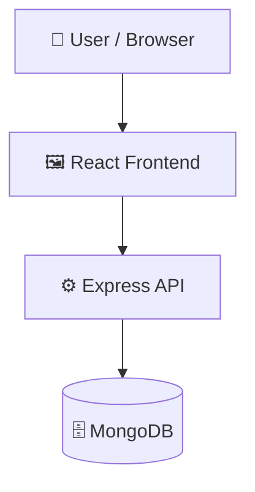

# ER

    
## 📑 Table of Contents

- [Description](#description)
- [Tech Stack](#tech-stack)
- [Architecture](#architecture)
- [Quick Start](#quick-start)
- [Key Dependencies](#key-dependencies)
- [Available Scripts](#available-scripts)
- [Project Structure](#project-structure)
- [Development Setup](#development-setup)
- [Contributors](#contributors)
- [Contributing](#contributing)


## 📝 Description

ER — a backend api built with Express.js, JavaScript, MongoDB, React, Tailwind CSS, Vite.

## 🛠️ Tech Stack

     

**Notable libraries:** Mongoose

## 🏗️ Architecture

A high-level view of how the main pieces fit together:



## ⚡ Quick Start

```bash

# 1. Clone the repository
git clone https://github.com/Alone-Prodipta/ER.git

# 2. Install dependencies
npm install

# 3. Start the dev server
npm run dev
```

## 📦 Key Dependencies

```
@xyflow/react: ^12.12.0
bootstrap: ^5.3.8
cors: ^2.8.6
dotenv: ^18.0.5
express: ^5.2.1
mongoose: ^9.10.4
react: ^19.2.8
react-dom: ^19.2.8
tailwindcss: ^4.3.3
```

## 🚀 Available Scripts

- **dev** — `npm run dev`
- **build** — `npm run build`
- **lint** — `npm run lint`
- **preview** — `npm run preview`

## 📁 Project Structure

```
modelling
├── eslint.config.js
├── index.html
├── package.json
├── src
│   ├── App.css
│   ├── App.jsx
│   ├── TableNode.jsx
│   ├── backend
│   │   └── server.database.js
│   ├── index.css
│   └── main.jsx
└── vite.config.js
```

## 🛠️ Development Setup

### Node.js / JavaScript
1. Install Node.js (v18+ recommended)
2. Install dependencies: `npm install` (or `yarn` / `pnpm install` / `bun install`)
3. Start the dev server: see the **Quick Start** above

## 👥 Contributors

Thanks to everyone who has contributed to this project:

<p align="left">
<a href="https://github.com/Alone-Prodipta" title="Alone-Prodipta"></a>
</p>

[See the full list of contributors →](https://github.com/Alone-Prodipta/ER/graphs/contributors)

## 👥 Contributing

Contributions are welcome! Here's the standard flow:

1. **Fork** the repository
2. **Clone** your fork: `git clone https://github.com/Alone-Prodipta/ER.git`
3. **Branch**: `git checkout -b feature/your-feature`
4. **Commit**: `git commit -m 'feat: add some feature'`
5. **Push**: `git push origin feature/your-feature`
6. **Open** a pull request

Please follow the existing code style and include tests for new behavior where applicable.
