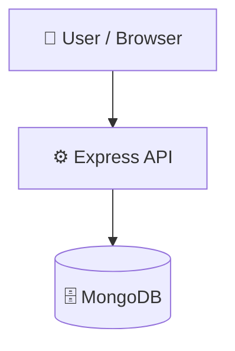

# ER

> Full-stack database diagramming application built with React, Express, and MongoDB.

      

## 📑 Table of Contents

- [Description](#description)
- [Key Features](#key-features)
- [Use Cases](#use-cases)
- [Tech Stack](#tech-stack)
- [Architecture](#architecture)
- [Quick Start](#quick-start)
- [Key Dependencies](#key-dependencies)
- [Available Scripts](#available-scripts)
- [API Endpoints](#api-endpoints)
- [Project Structure](#project-structure)
- [Development Setup](#development-setup)
- [Deployment](#deployment)
- [Contributors](#contributors)
- [Contributing](#contributing)
- [License](#license)

## 📝 Description

ER is a database modeling and diagramming web application designed to support entity-relationship design and persistence. It combines a client-side modeling interface with a dedicated backend service to handle diagram workflows, storage, and application data management.

The system is split into two core components: a React-based frontend in the modelling directory bundled with Vite, and an Express.js backend server. The backend initializes a connection to MongoDB using Mongoose, enforces origin-checked CORS middleware, and delegates incoming HTTP requests to dedicated authentication and diagram routes with centralized error handling.

## ✨ Key Features

- **📊 Diagram Management Routes** — Exposes dedicated diagram routing modules in Express to handle diagram operations.
- **🔐 Authentication Routing** — Provides dedicated authentication route handlers to manage user access and sessions.
- **🗄️ MongoDB and Mongoose Persistence** — Connects to a MongoDB database instance on startup using Mongoose for document modeling.
- **💻 React and Vite Frontend** — Delivers an interactive user interface built with React, Vite, and Tailwind CSS in the modelling workspace.
- **🛡️ Configurable CORS Middleware** — Restricts incoming non-safe HTTP methods to origins specified by the CORS_ORIGIN environment variable.

## 🎯 Use Cases

- Creating, editing, and persisting database entity-relationship diagrams in MongoDB.
- Serving as a decoupled full-stack architectural foundation using Express.js and React.
- Managing authenticated user sessions for database design and modeling tools.

## 🛠️ Tech Stack

   

## 🏗️ Architecture

A high-level view of how the main pieces fit together:



## ⚡ Quick Start

```bash

# 1. Clone the repository
git clone https://github.com/Alone-Prodipta/ER.git

# 2. Install dependencies
npm install

# 3. Start the dev server
npm run start
```

## 📦 Key Dependencies

```
dotenv: ^18.0.10
express: ^5.3.0
mongoose: ^9.13.0
nodemon: ^3.1.14
```

## 🚀 Available Scripts

- **start** — `npm run start`
- **dev** — `npm run dev`

## 🌐 API Endpoints

Detected endpoints (best-effort scan):

```
GET /api/health
POST /register
POST /login
POST /logout
GET /me
POST /save
GET /
GET /:id
DELETE /:id
```

## 📁 Project Structure

```
.
├── backend
│   ├── package.json
│   ├── server.js
│   └── src
│       ├── app.js
│       ├── config
│       │   └── environment.js
│       ├── controllers
│       │   ├── auth.controllers.js
│       │   └── diagram.controllers.js
│       ├── database
│       │   └── db.database.js
│       ├── middlewares
│       │   ├── errorHandler.middlewares.js
│       │   └── requireAuth.middlewares.js
│       ├── models
│       │   ├── authSession.models.js
│       │   ├── diagram.models.js
│       │   └── user.models.js
│       ├── routes
│       │   ├── auth.routes.js
│       │   └── diagram.routes.js
│       └── utilities
│           ├── diagram.serializer.js
│           └── passwords.js
└── modelling
    ├── api
    │   ├── app.ts
    │   ├── auth.ts
    │   └── passwords.ts
    ├── components
    │   ├── AccountMenu.jsx
    │   ├── App.jsx
    │   ├── AuthPage.jsx
    │   ├── DiagramCanvas.jsx
    │   ├── DiagramToolbar.jsx
    │   ├── DiagramWorkspace.jsx
    │   ├── SaveStatus.jsx
    │   ├── TableNode.jsx
    │   └── table
    │       ├── ColumnEditor.jsx
    │       ├── ColumnRow.jsx
    │       └── TableNameEditor.jsx
    ├── db
    │   ├── index.ts
    │   └── schema.ts
    ├── drizzle.config.ts
    ├── eslint.config.js
    ├── hooks
    │   └── useDiagramEditor.js
    ├── index.html
    ├── netlify
    │   ├── database
    │   │   └── migrations
    │   │       └── 20261125125437_create_users_sessions_diagrams
    │   │           └── ...
    │   └── server
    │       └── index.ts
    ├── netlify.toml
    ├── package.json
    ├── src
    │   ├── App.css
    │   ├── App.jsx
    │   ├── index.css
    │   └── main.jsx
    └── vite.config.js
```

## 🛠️ Development Setup

### Node.js / JavaScript
1. Install Node.js (v18+ recommended)
2. Install dependencies: `npm install` (or `yarn` / `pnpm install` / `bun install`)
3. Start the dev server: see the **Quick Start** above

## 🚢 Deployment

### Netlify

This project is configured for [Netlify](https://netlify.com). Connect the repo or run `netlify deploy`.

## 👥 Contributors

Thanks to everyone who has contributed to this project:

<p align="left">
  <a href="https://github.com/Alone-Prodipta" title="Alone-Prodipta">
    
  </a>
  <a href="https://github.com/netlify-bot" title="netlify-bot">
    
  </a>
</p>

[See the full list of contributors →](https://github.com/Alone-Prodipta/ER/graphs/contributors)

## 👥 Contributing

Contributions are welcome! Here's the standard flow:

1. **Fork** the repository
2. **Clone** your fork: `git clone https://github.com/Alone-Prodipta/ER.git`
3. **Branch**: `git checkout -b feature/your-feature`
4. **Commit**: `git commit -m 'feat: add some feature'`
5. **Push**: `git push origin feature/your-feature`
6. **Open** a pull request

Please follow the existing code style and include tests for new behavior where applicable.
